# Entrega Já · Site

Site da plataforma de delivery, para os quatro perfis:

| Área | Caminho | Para quem |
|---|---|---|
| Vitrine, loja, sacola, pedidos e acompanhamento | `/`, `/lojas/:id`, `/sacola`, `/pedidos` | Cliente |
| Entrar, cadastro, convite, esqueci minha senha e nova senha | `/entrar`, `/cadastro`, `/convite/:token`, `/esqueci-senha`, `/redefinir-senha/:token` | Todos |
| Painel da loja: pedidos (kanban), cardápio, equipe, dados, horário de funcionamento e automação | `/loja` | Dono, gerente e atendente |
| Corridas, ganhos, histórico, perfil e veículo | `/entregador` | Entregador |
| Visão geral, pedidos, aprovações, denúncias, lojas, contas, auditoria e regras | `/admin` | Admin da plataforma |
| Catálogo do design system | `/design-system` | Quem desenvolve |

**Stack:** React 19, Vite, Tailwind CSS v4, React Router, TanStack Query e Virtual, Leaflet.

A API fica no projeto `entrega-ja-api`.

## Telas

**Cliente:** vitrine, cardápio com abas por seção e acompanhamento da entrega no mapa.

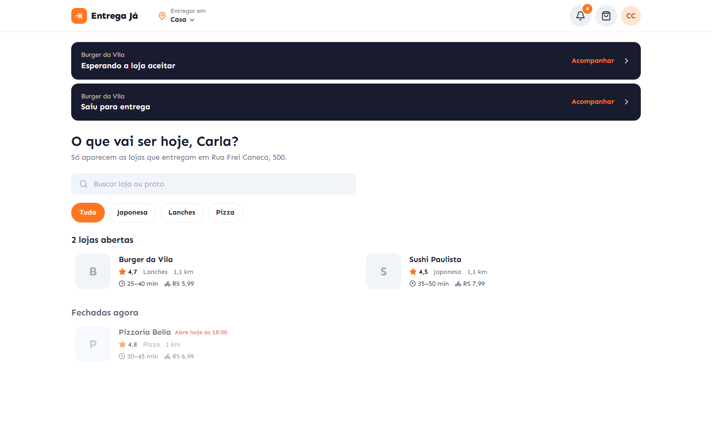
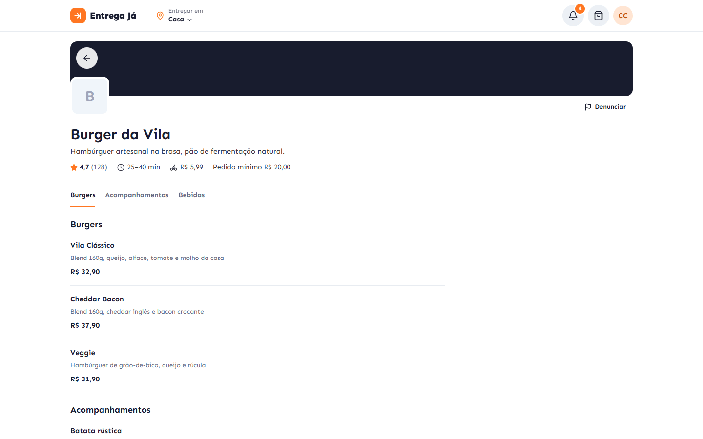
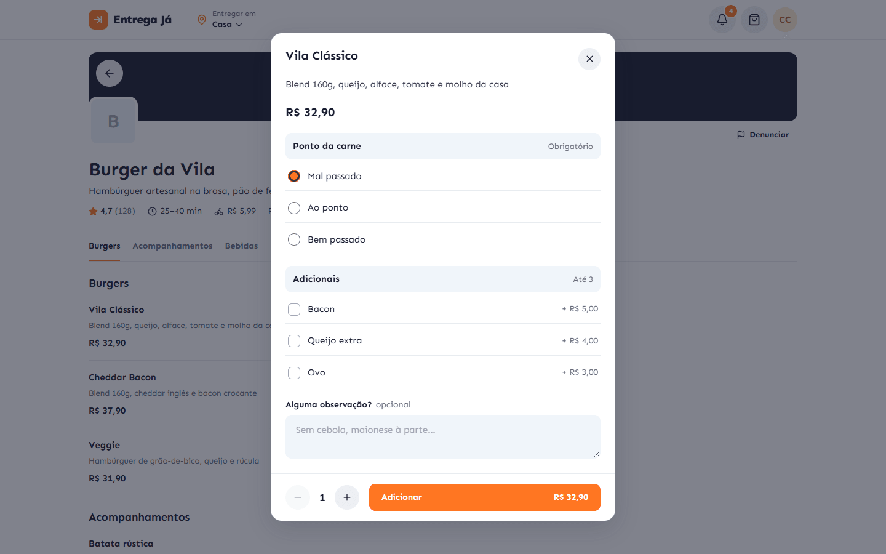
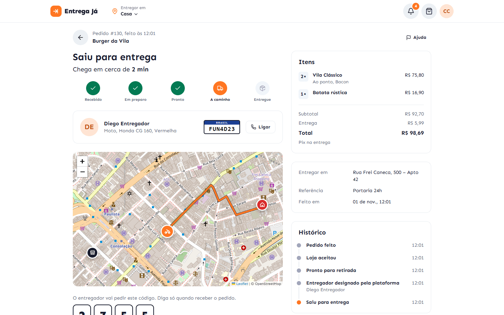

**Loja:** kanban de pedidos, cardápio, horário de funcionamento e painel.

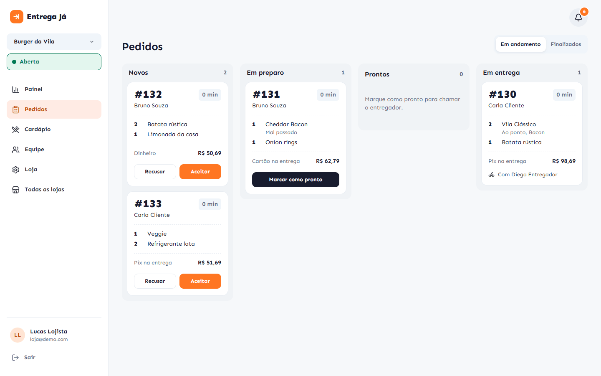
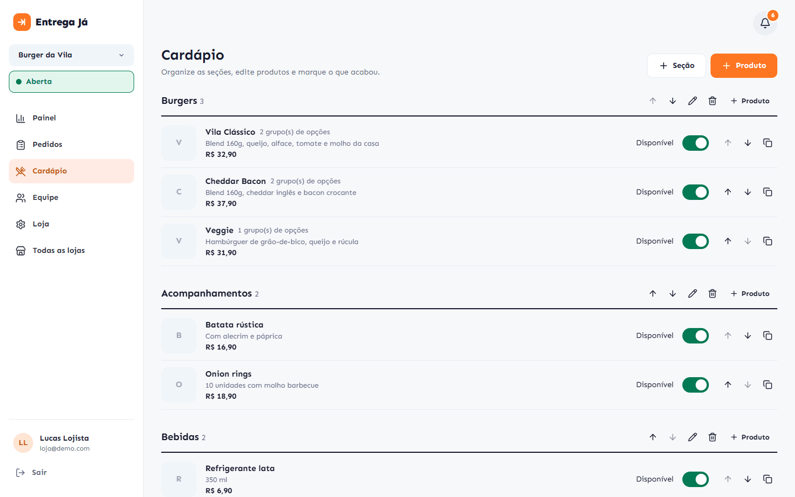
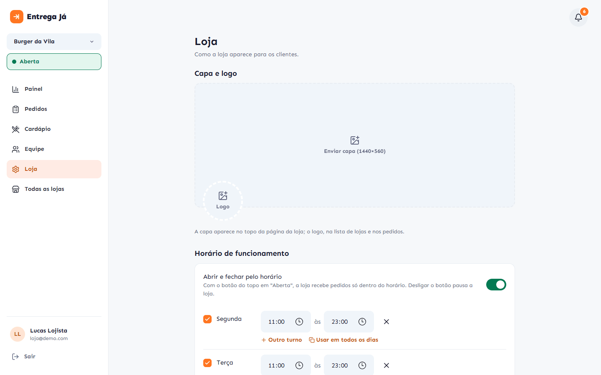
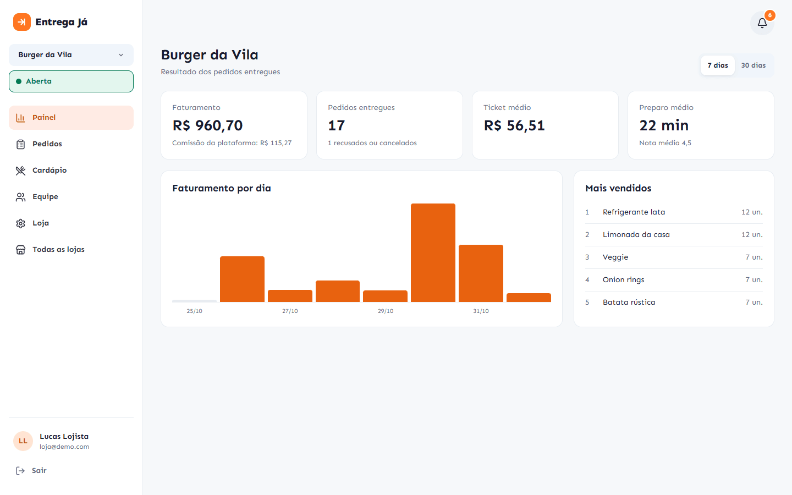

**Entregador e admin:**

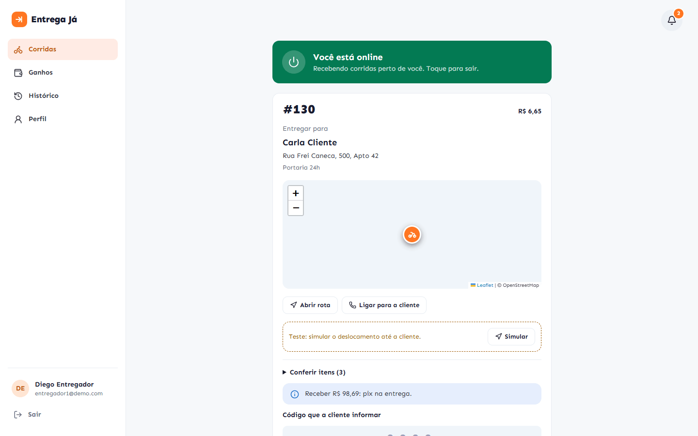
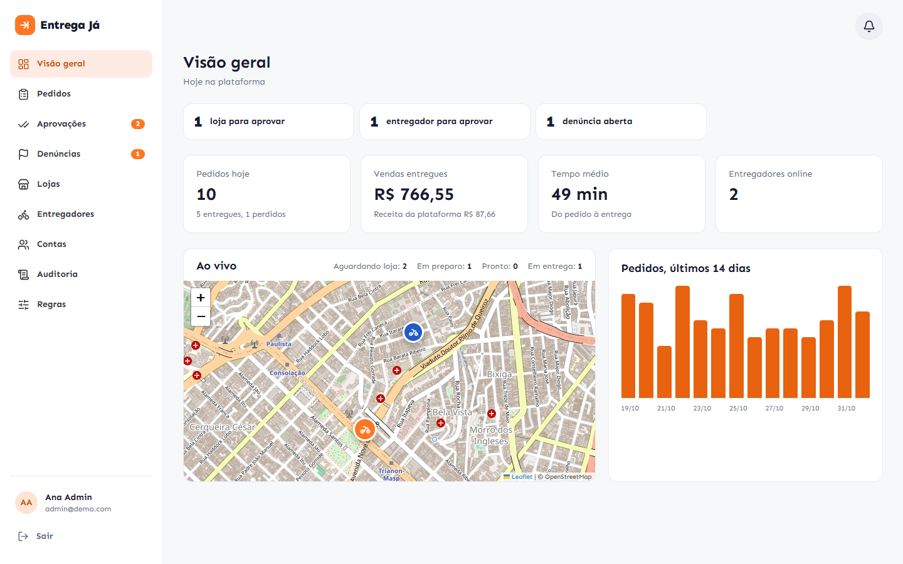
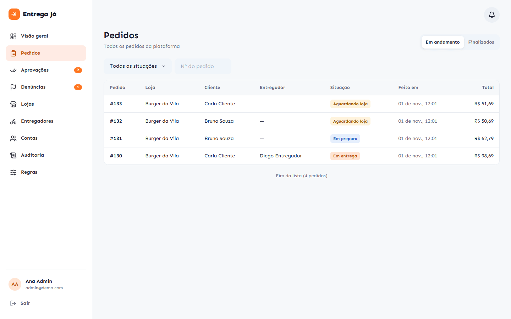

**No celular:**

| Vitrine | Cardápio | Acompanhamento | Kanban | Entregador |
|---|---|---|---|---|
| 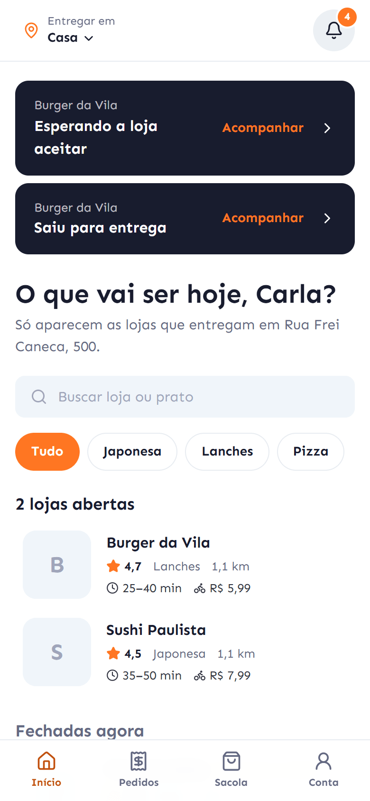 | 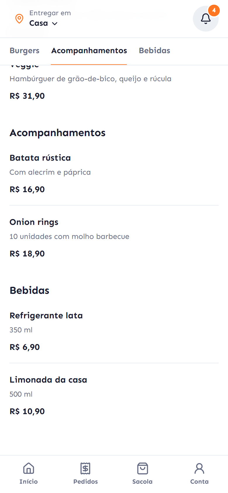 | 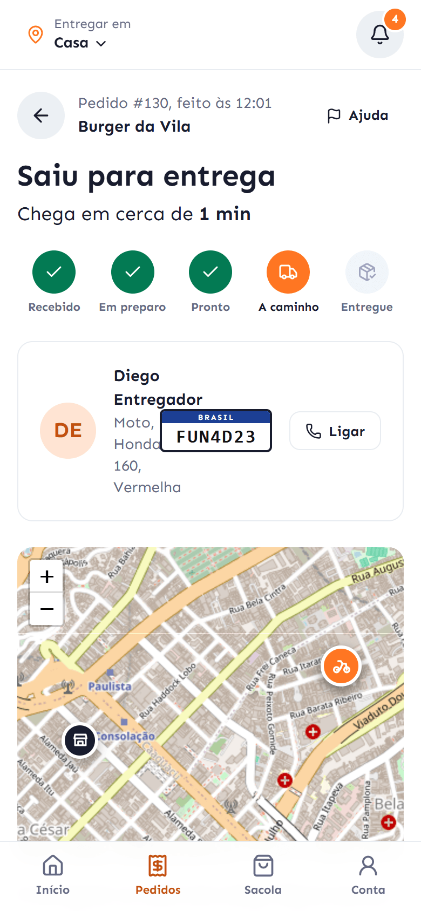 | 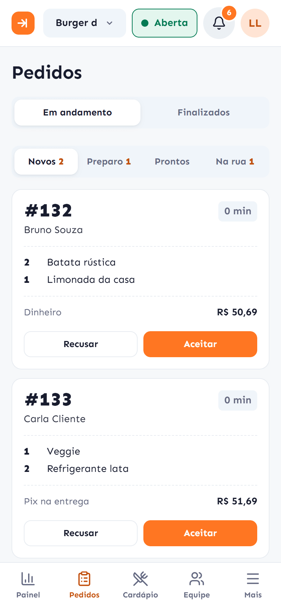 | 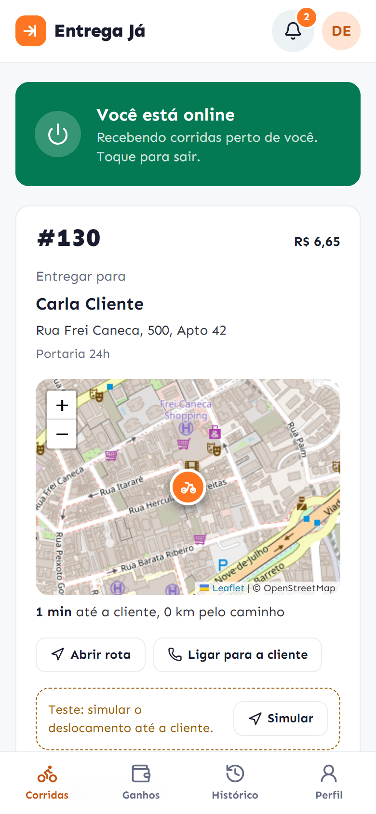 |

Também: [entrar](docs/prints/entrar.png) e o [catálogo do design system](docs/prints/design-system.png).

## Rodar

```bash
npm install
# API rodando em http://localhost:3000 (veja entrega-ja-api)
npm run dev              # http://localhost:5173, /api vai para a API pelo proxy do Vite
API_URL=http://localhost:3100 npm run dev   # API em outra porta
```

Build de produção:

```bash
VITE_API_URL=https://sua-api.exemplo.com/api npm run build   # gera dist/
```

| Variável | Para quê |
|---|---|
| `VITE_API_URL` | Endereço da API. Vazio usa `/api` no mesmo domínio |
| `VITE_DEMO_TOOLS` | `true` liga as ferramentas de teste no build (simulador de deslocamento do entregador, contas demo no login). Em `npm run dev` elas já vêm ligadas; **em produção, deixe vazio**: o código delas nem entra no pacote |

## Organização

```
src/
  index.css          tokens do design system (cores, raios, sombras) e base
  ds/                componentes do design system (sem regra de negócio)
  lib/               api, login, tempo real (SSE), push, rotas, formatação, tipos, media queries
  features/
    shared/          estrutura das telas, notificações, mapa, pedido, conta, denúncia
    auth/            entrar, cadastro, convite para equipe, esqueci minha senha
    customer/        vitrine, loja, sacola, pedidos e acompanhamento, endereços
    merchant/        lojas, kanban de pedidos, cardápio, equipe, dados e automação
    courier/         turno (online), ofertas, entrega, ganhos, veículo, simulador de teste
    admin/           visão geral, pedidos e atribuição, aprovações, moderação, regras
```

Os painéis (`merchant`, `courier`, `admin`) e o catálogo do design system carregam sob
demanda: quem só compra não baixa o código do admin.

## Design system

- **Tokens** em `src/index.css`: variáveis CSS (`--c-primary`, `--c-ink`…) com versão para modo
  escuro, expostas ao Tailwind pelo `@theme inline` (`bg-primary`, `text-ink`, `rounded-card`…).
  Para trocar a marca, mude as variáveis `--c-primary*`.
- **Componentes** em `src/ds`:
  - botões: `Button`, `IconButton`, `TextButton`, `CountBadge`;
  - formulário: `Field`, `Input`, `MoneyInput`, `Select`, `Textarea`, `SearchInput`, `Checkbox`, `OptionCard`, `Switch`, `Segmented`, `Tabs`, `Chip`, `Stepper`, `StarInput`, `ImagePicker`;
  - exibição: `Card`, `PageHeader`, `Alert`, `Badge`, `Avatar`, `Thumb`, `Stat`, `DescriptionList`, `EmptyState`, `Skeleton`, `Rating`, `BarChart`;
  - sobreposição: `Dialog` (rodapé à direita ou `footerFull`), `Drawer`, `useConfirm` (com motivo), `useToast`;
  - listas: `VirtualList` (rola com a janela; `handle` para rolar até um item e saber qual está no topo), `VirtualScroller` (rola dentro de um contêiner), `VirtualRows` (tabelas), `Table`, `LoadMore`.
- **Catálogo vivo:** abra `/design-system`.
- **Direção visual:** tipografia forte (Sen), informação densa e sem enfeite. Divisórias em vez de
  caixa dentro de caixa, foto do produto como destaque e cantos com hierarquia (6/10/14/18 px).
  Os pedidos da loja têm cara de comanda de cozinha.

## Celular e computador

O mesmo site serve as duas telas; abaixo de 640px (`sm`) vale o layout de celular.

- **Navegação dos painéis** (`features/shared/Shell.tsx`): no computador, menu lateral fixo; no
  celular, barra inferior com até 5 itens. Quando sobra item (ou há itens só de computador), a barra
  mostra 4 e o resto vai para **Mais**. Página aberta pelo "Mais" (ou pelo perfil) ganha uma seta de
  **voltar** no topo, e o "Mais" fica marcado como ativo.
- **Botões:** no celular, botão sozinho na linha ocupa a largura toda (regra no próprio `Button`:
  único filho do contêiner ou item de grade). Ações do cabeçalho da página descem para uma linha
  própria e dividem a largura.
- **Janelas** viram painel que sobe de baixo; o rodapé de ações fica fixo.
- Nada rola na horizontal, exceto tabelas e faixas de abas/categorias, que rolam dentro do próprio espaço.

## Listas

Toda lista que cresce com os dados é virtualizada: só os itens perto da tela ficam no DOM.

| Onde | Componente |
|---|---|
| Vitrine (1 ou 2 lojas por linha), cardápio da loja, cardápio do lojista, lojas do lojista, equipe, endereços, aprovações, histórico | `VirtualList` (rolagem da janela) |
| Kanban (cada coluna rola sozinha), convites, notificações, entregadores na atribuição, equipe e produtos nas gavetas do admin | `VirtualScroller` (rolagem do contêiner) |
| Tabelas do admin, pedidos finalizados da loja | `VirtualRows` |

Listas paginadas buscam a próxima página perto do fim (`onEnd`). Grades usam `chunk()` de
`lib/useMedia.ts` para montar linhas com o número de colunas da largura atual.

## Abas que seguem o conteúdo

- **Página da loja:** as seções do cardápio ficam numa barra fixa. Tocar leva até a seção; rolar
  marca a seção atual (inclusive a última, quando a página acaba antes). Só aparecem seções com produtos.
- **Vitrine:** as categorias saem das lojas que entregam no endereço escolhido, então nenhuma leva a
  uma lista vazia; com uma categoria só, a faixa some.

## Tempo real e notificações

- Uma conexão SSE por aba (`lib/realtime.tsx`): avisos novos entram na central (sininho),
  pedidos mudam em todas as listas abertas e o entregador recebe ofertas com bip.
- **Push no navegador** (`lib/push.ts` + `public/sw.js`): a pessoa ativa na central ou em
  Minha conta. O botão de teste manda um aviso de verdade. Com o site aberto e em foco, o
  sistema não repete o aviso que já apareceu na tela.

## Mapa e rotas

`lib/route.ts` pede à API o melhor caminho pelas ruas (OSRM ou Mapbox, configurado na API):

- a linha mostra só o que falta percorrer, com um brilho que corre até o destino;
- a rota só é recalculada quando o entregador sai dela;
- o ícone do entregador desliza entre as atualizações de GPS;
- a cliente vê "chega em cerca de N min".

## Esqueci minha senha

Em **Entrar → Esqueci minha senha**, a pessoa informa o e-mail e a API manda um link
`/redefinir-senha/<token>` (vale 1 hora, uma vez só). A página confere o link antes de pedir a senha
nova, mostra o e-mail mascarado e, ao salvar, já entra na conta; as outras sessões são encerradas.
O link vale para todos os perfis, inclusive para quem usa o app do entregador.

## Horário de funcionamento

Em **Loja → Dados**, o dono ou gerente define um ou mais turnos por dia (fechamento menor que a
abertura passa da meia-noite). Com horário, a loja abre e fecha sozinha e o botão do topo vira pausa:
**Aberta**, **Fora do horário** (ligado, mas fechada pelo horário) ou **Pausada**. A cliente vê
"Abre hoje às 18:00" na lista e na página da loja, com os horários da semana.

## Online do entregador

O "online" fica salvo na conta: quem estava online volta sozinho ao abrir o site. Enquanto
online, o GPS manda a posição a cada ~8 s.

## CI

O workflow `CI` roda a checagem de tipos e o build a cada push e pull request.

## Deploy (Vercel)

Importe o repositório, framework Vite e a variável `VITE_API_URL`. O `vercel.json` já cuida da
navegação (toda rota cai no `index.html`), do `sw.js` sem cache e do cache longo dos assets.
